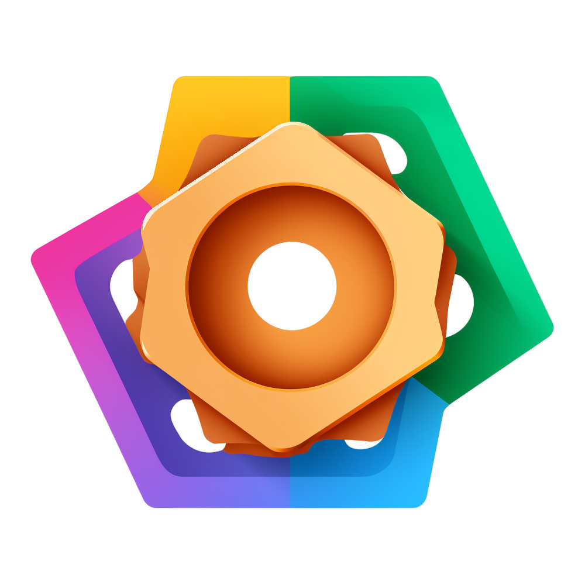

# Kodex

<p align="center">
  
</p>

Kodex — web-first платформа управления ИИ-сотрудниками и выполняемыми ими
Процессами для продаж, поддержки, финансов, юридической работы, контента,
аналитики, разработки и операционной деятельности.

Основной интерфейс — `services/staff/control-center`. Пользователь может без
внешних интеграций создать Проект и ИИ-сотрудника, запустить Agent/Workflow,
наблюдать live graph, продолжить Session, принять Human Gate и скачать artifact.

## Runtime

- `control-plane` владеет продуктовым состоянием, authorization, lifecycle,
  audit, idempotency, graph/events и transactional outbox;
- `runtime-controller` запускает каждый обычный turn в новом Kubernetes Pod из
  exact promoted Docker image роли;
- `role-image-builder` собирает индивидуальные окружения ролей через rootless
  BuildKit, supply chain проверяет SBOM/provenance/signature и promotion;
- защищённый `agent-runner` внутри role image запускает model provider и
  разрешённые типизированные MCP-инструменты;
- `integration-gateway` выполняет только поставляемые typed capabilities,
  получает Secret revision metadata из `control-plane` и отделяет Human Gate
  от claim любого внешнего изменения;
- системный помощник использует отдельный always-hot runtime;
- Mattermost — optional interaction adapter, а GitHub, GitLab, Kubernetes,
  CRM/ERP/email/storage — равноправные необязательные integrations.

## Документация

- [навигация и источники истины](docs/README.md);
- [продуктовая модель](docs/product/README.md);
- [целевая web-first архитектура](docs/architecture/web-first-platform-reset.md);
- [runtime и role Pod](docs/architecture/runtime-controller.md);
- [домены](docs/domains/README.md);
- [утверждённые HTML-макеты](docs/design/mockups/index.md);
- [эксплуатационные профили](docs/operations/deployment-profiles.md);
- [чистая установка](docs/runbooks/fresh-install.md);
- [Keycloak и административные интерфейсы](docs/runbooks/identity-and-management-surfaces.md).

Поддерживаемые Kustomize profiles:

- `deploy/k8s/profiles/web-only`;
- `deploy/k8s/profiles/web-with-mattermost`.

Public domain, Origin, OIDC, registry и external hosts передаются параметрами
развертывания; репозиторий не фиксирует домен конкретного владельца.

## Установка

Единая точка входа использует локальный файл `.kodex-env` с правами `0600`:

```bash
cp .kodex-env.example .kodex-env
chmod 0600 .kodex-env
```

Для пустого Linux x86_64 сервера установщик поднимает k3s, TLS/OIDC,
наблюдаемость, registry, ARC/BuildKit и платформу:

```bash
sudo ./install.sh --non-interactive --components all
```

В готовом Kubernetes можно установить только данные и deployable Kodex:

```bash
./install.sh --components secrets,platform
```

Во втором сценарии `.kodex-env` указывает существующие HTTPS OIDC/registry и
self-hosted runner contracts. Полный перечень параметров, порядок reset,
secret model и readback приведены в
[runbook чистой установки](docs/runbooks/fresh-install.md).

Опциональный [переносимый профиль](docs/runbooks/portable-install.md) разделяет
bundled и external OIDC, собственный TLS и внешний HTTPS proxy. Локальный
`./install.sh --portable-release` потребляет exact render из CI/CD установки;
параметры установки не требуется записывать в GitHub.

## Лицензия

Код распространяется по [лицензии MIT](LICENSE).

### Версионированные env inputs image policy

По умолчанию `--image-policy-inputs-mode direct` сохраняет прежние ссылки на
canonical ConfigMap. Для обновлений immutable policy доступен опциональный
`versioned`: передайте `--image-policy-inputs-mode versioned` в
`tools/release/render-web-only.sh` либо подготовьте render командой
`python3 tools/install/image_policy_inputs.py --mode versioned --render desired.yaml`,
затем закрепите новый SHA256 render и передайте
`--image-policy-inputs-mode versioned` во все команды portable release, включая
plan/preflight/readback. Профиль не применяется молча к уже закреплённому render.

Профиль создаёт immutable env-проекцию с именем по содержимому canonical policy и
меняет ссылки control-plane, role-image-builder, runtime-controller и registry-pull.
Повторная materialization идемпотентна; изменённые inputs получают новое имя.
Canonical owner policy, API/RBAC, image pins и credentials references сохраняются.
Независимый runtime sandbox profile и его VAP binding не переключаются этим
параметром. Старые проекции сохраняются до отдельного проверенного GC, чтобы
не отнять inputs у ещё работающих Pod. Только render/readback не доказывает
прочитанные процессом env: после rollout сверяйте безопасные metadata политики
и проверяйте новую сборку/допуск без ручного изменения admission history.

Это учитывает [поведение immutable ConfigMap](https://kubernetes.io/docs/concepts/configuration/configmap/#immutable-configmaps):
для новых inputs используется новое имя, прежние потребители сохраняют старую
проекцию до завершения rollout. Номер и содержательный digest политики определяет
существующий canonical owner; профиль их не пересчитывает и не ослабляет.

### Опциональный бюджет памяти сканирования образов

Компонент `deploy/k8s/components/image-admission-memory-budget` добавляется в
Kustomize overlay, который уже включает image supply chain. Он задаёт
`scan-go-memory-limit-mib=1536` в ConfigMap `kodex-image-admission`.
Без компонента прежний запуск сохраняется. Значение можно явно переопределить
в своём overlay: целое число MiB от 128 до 65536, не более 75% конечного
`/sys/fs/cgroup/memory.max`. Профиль требует cgroup v2; отсутствие/неверный limit
закрывает scan до запуска инструмента. Default scan Job имеет жёсткий limit 2Gi;
компонент его не увеличивает и не меняет requests/limits других фаз.

Wrapper передаёт `GOMEMLIMIT` только Syft/Grype. Это мягкий бюджет Go runtime,
а не жёсткий предел RSS и не гарантия отсутствия OOM. Полнота SBOM, catalogers,
vulnerability policy, CA/mTLS, подпись, image subject и owner receipts сохраняются.
ClamAV проверяет загружаемые файлы отдельно и этим компонентом не управляется.

Оператор закрепляет source/render, применяет согласованный ConfigMap целиком и
проверяет его data перед новой попыткой admission. При timeout сначала readback,
без слепого повторного create/build. После технического отказа использовать штатный
owner retry того же artifact, если он разрешён; не менять историю вручную.
Успех wrapper-тестов не заменяет installed scan/admission. Для возврата удалить
компонент/ключ бюджета и повторить render/apply; прежние receipts не переписываются.
Проверки: `make test-scan-memory-budget` и image supply-chain fixtures.

Проверены [документы Syft через Context7](https://github.com/anchore/syft/wiki/Configuration),
[Go memory limit](https://go.dev/doc/gc-guide#Memory_limit) и
[go.mod Syft v1.51.0](https://github.com/anchore/syft/blob/v1.51.0/go.mod).
Документация main не доказывает поведение закреплённой версии; actual OOM/result
проверяются отдельно на устанавливаемом образе.
